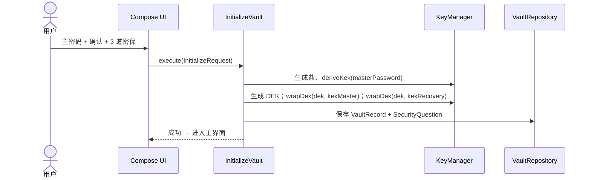
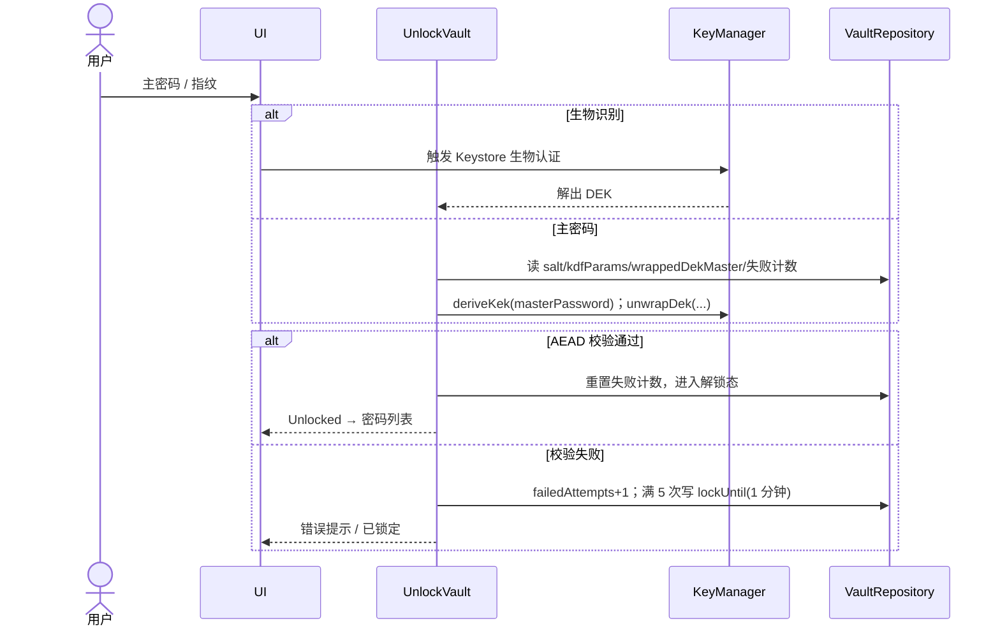
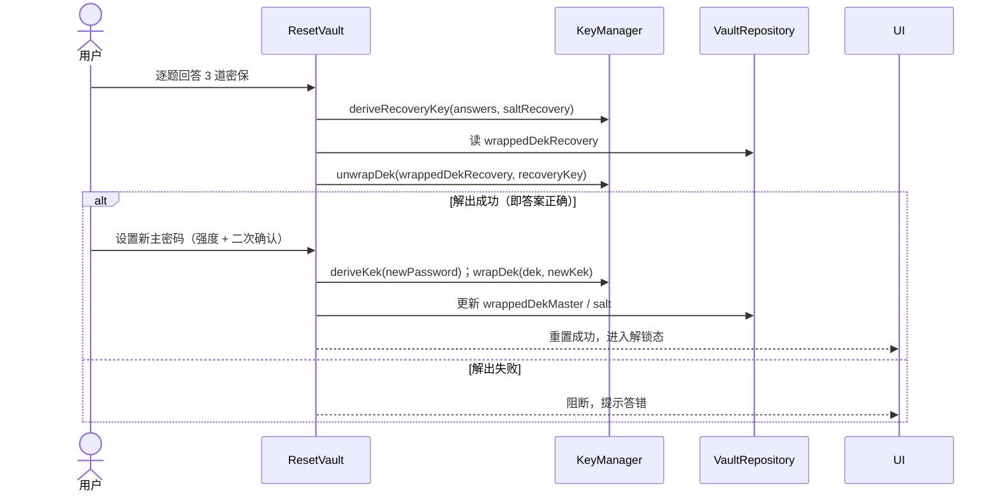

# 密码管理 App —— 技术方案

> 依据：`密码管理App_需求规格说明书.md`（v0.4）、`features/*.feature`、`架构视图.md`、`openapi.yaml`（预留）。
> 定位：Android 原生、纯本地、无服务端、个人使用。本文给出技术选型、架构、数据模型、接口、时序、任务拆解与风险。
> 版本：v0.2（架构决策已定，2026-09-21）。

---

## 1. 推荐技术栈与框架（含理由）

| 层次 | 选型 | 理由 |
|---|---|---|
| 语言 | **Kotlin** | Android 现代标准；协程天然适配；空安全降低崩溃 |
| UI | **Jetpack Compose + Material 3** | 声明式、状态驱动，契合「密码掩码/显隐」等强交互；开发效率高 |
| 架构 | **MVVM + 单向数据流（UDF）+ 分层** | 状态单一来源，便于测试与安全审计 |
| 依赖注入 | **Hilt** | 官方推荐，减少样板 |
| 异步 | **Kotlin Coroutines + Flow** | 响应式；解锁态/锁定态用 `StateFlow` 驱动 |
| 本地存储 | **Room + SQLCipher** | 结构化查询（5000 条搜索/过滤）+ 整库静态加密（满足 NFR-S1 明文不落盘） |
| 密钥管理 | **Android Keystore（硬件级）+ Google Tink** | 密钥不出安全区；生物识别用 Keystore 授权解锁 |
| 密钥派生 KDF | **Argon2id**（备选 PBKDF2-HMAC-SHA256） | 抗 GPU/内存暴力破解，移动端参数需调优 |
| 加密切片 | **AES-256-GCM（AEAD）** | 认证加密，篡改即失效 |
| 生物识别 | **androidx.biometric** | 统一指纹/面容 API |
| 自动填充 | **Autofill Framework（AutofillService）** | 系统级填充，覆盖浏览器/三方 App |
| TOTP | **RFC 6238（HMAC-SHA1 + Base32）** | 与主流站点兼容 |
| 构建 | **Gradle Kotlin DSL + version catalog** | 依赖集中、可复现 |
| 测试 | **JUnit / MockK / Turbine / Robolectric / Compose-UI-Test** | 分层层验证 |
| BDD 衔接 | 可选 **Cucumber-Android** 或 Gherkin→Espresso 映射 | 与 `features/*.feature` 对齐 |

> 版本基线：minSdk = API 26（Android 8.0+）；targetSdk = 当前最新稳定版（已定，见 §10）。

---

## 2. 整体架构设计

采用 **分层 + 单向数据流**，Domain 层为纯 Kotlin（不含 Android 依赖），便于测试与替换。

```mermaid
flowchart TB
    subgraph UI[表现层]
        Screen[Compose UI]
        VM[ViewModel + UiState / UDF]
    end
    subgraph Domain[领域层（纯 Kotlin）]
        UC[UseCase 用例]
        Ports[Repository 端口接口]
    end
    subgraph Data[数据层]
        Repo[Repository 实现]
        Room[(Room + SQLCipher)]
        KS[Android Keystore]
        File[(备份文件)]
    end
    subgraph Platform[平台层（系统服务）]
        Bio[Biometric]
        AF[AutofillService]
        Clip[ClipboardManager]
    end

    Screen --> VM --> UC
    UC --> Ports
    Ports <-.实现.- Repo
    Repo --> Room
    Repo --> KS
    Repo --> File
    UC --> Bio
    UC --> AF
    UC --> Clip
```

**核心原则**

1. **安全边界内聚**：所有「敏感值不进明文、不入日志、不出进程」的处理集中在 `crypto` 与 `vault` 模块，UI 层拿不到原始密钥。
2. **解锁态门禁**：`VaultState`（Locked / Unlocked(session)）作为全局 `StateFlow`，所有用例入口执行前校验锁定态（对应 BR-7）。
3. **数据单向流**：事件 → `ViewModel` → `UseCase` → `Repository` → 结果回写 `UiState`；无 UI 直连存储。
4. **预留边界**：`openapi.yaml` 描述的远程 API 本期不实现；如需将来加后端，只需在 Data 层加一个远程 DataSource 实现同一组 `Repository` 端口。

---

## 3. 模块划分与职责

| 模块 | 职责 | 关键约束/对应需求 |
|---|---|---|
| `auth` | 主密码校验、生物识别开通/快捷解锁、连续 5 次限流 | FR-2、FR-1 |
| `crypto` | KDF、wrap/unwrap DEK、AES-GCM 加解密、Keystore 交互 | NFR-S1/S2 |
| `vault` | 密码库元数据、密保问题、失败计数、锁定状态、会话 | FR-1、FR-8、FR-12 |
| `entries` | 条目增删改查、分类/标签/搜索、5000 上限、删除二次确认 | FR-3、FR-5 |
| `generator` | 密码生成（长度/字符集/排除易混淆） | FR-4 |
| `totp` | Base32 解析 + RFC6238 动态码 | FR-11 |
| `autofill` | AutofillService、条目匹配、多候选 | FR-6 |
| `backup` | 加密导出、加密/CSV 导入、重复跳过 | FR-7 |
| `clipboard` | 掩码显隐、复制、30 秒清理 | FR-9 |
| `lock` | 切后台/空闲自动锁定 | FR-8 |
| `core` | 通用工具、DI、日志脱敏、Result 封装 | — |

---

## 4. 数据模型设计

### 4.1 实体与表

| 实体 | 字段 | 说明 |
|---|---|---|
| `VaultRecord` | id, saltKdf, kdfParams, wrappedDekMaster, wrappedDekRecovery, saltRecovery, failedAttempts, lockUntil, biometricEnabled | 密码库根元数据；`wrappedDek*` 均为加密二进制，不存主密码/答案 |
| `SecurityQuestion` | id, position, questionText | 只存「问题」文本（供找回时展示）；**答案不落盘** |
| `Entry` | id, title, username, passwordCipher, url, notes, categoryId, createdAt, updatedAt, totpSecretCipher | `passwordCipher`/`totpSecretCipher` 用 DEK 二次加密 |
| `Category` | id, name | 1–30 字符 |
| `Tag` | name | 1–30 字符 |
| `EntryTag` | entryId, tag | 多对多；单条 ≤20 |

> 字段长度/必填约束与需求 §6 一致。整库由 SQLCipher 加密（NFR-S1）；`passwordCipher`、`totpSecretCipher` 额外用 DEK 做字段级加密（纵深防御，见 §10 决策点）。

### 4.2 密钥与加密模型（核心）

```
主密码 ──Argon2id──> KEK_master ──wrap──> DEK ──encrypt──> SQLCipher 密钥
密保答案组合 ──KDF──> KEK_recovery ──wrap──> DEK（用于找回重置）
生物识别 ──Keystore(setUserAuthenticationRequired)──> 授权解出 DEK（快捷解锁）
```

- **DEK（数据加密密钥）为唯一数据根密钥**，随机生成，永不明文落盘。
- 主密码与密保答案**都不直接存储**；能否用它们正确解出 DEK（AEAD 校验）即「答对/答错」的判据——因此密保答案不需要明文/哈希落盘。
- **忘记主密码的找回**：用密保答案派生的 `KEK_recovery` 解出 DEK，再用新主密码重新包裹 DEK —— 由此实现「重置主密码且数据保留」。
- 生物识别快捷解锁：DEK 被一个 `setUserAuthenticationRequired(true)` 的 Keystore 密钥包裹，指纹/面容验证通过才释放。

---

## 5. API 接口设计（内部接口签名）

> 仅内部接口；敏感参数一律 `CharArray`（可清零），尽量 `Result` 返回。

```kotlin
// crypto / 密钥
interface KeyManager {
    fun deriveKek(password: CharArray, salt: ByteArray, params: KdfParams): ByteArray
    fun wrapDek(dek: ByteArray, kek: ByteArray): ByteArray
    fun unwrapDek(wrapped: ByteArray, kek: ByteArray): ByteArray
    fun encrypt(data: ByteArray, key: ByteArray): ByteArray   // AES-256-GCM
    fun decrypt(ciphertext: ByteArray, key: ByteArray): ByteArray
}

// vault / 认证与会话
interface VaultRepository {
    suspend fun initialize(req: InitializeRequest): Result<Unit>
    suspend fun unlock(password: CharArray): Result<Session>
    fun lock()
    suspend fun resetViaSecurityAnswers(answers: List<String>, newPassword: CharArray): Result<Unit>
    suspend fun changeMasterPassword(current: CharArray, new: CharArray): Result<Unit>
    suspend fun setBiometric(enabled: Boolean, password: CharArray): Result<Unit>
    val state: Flow<VaultState>            // Locked | Unlocked
}

// entries
interface EntryRepository {
    fun search(query: String, categoryId: String?, tag: String?): Flow<List<EntrySummary>>
    suspend fun get(id: String): Entry?
    suspend fun create(input: EntryInput): Result<String>      // 强校验 + 5000 上限
    suspend fun update(id: String, input: EntryInput): Result<Unit>
    suspend fun delete(id: String): Result<Unit>               // 调用方二次确认
    suspend fun revealPassword(id: String): Result<CharArray>  // 仅在解锁态
}

// backup
interface BackupRepository {
    suspend fun export(password: CharArray): Result<ByteArray>
    suspend fun import(file: ByteArray, password: CharArray): Result<ImportSummary>
    suspend fun importCsv(file: ByteArray): Result<ImportSummary>
}
```

配套领域模型（要点）：`VaultState`、`Session`、`EntryInput`、`ImportSummary(imported, skipped, errors)`、`KdfParams`。

---

## 6. 关键流程与时序

### 6.1 首次初始化



### 6.2 解锁与生物识别



### 6.3 忘记主密码找回



---

## 7. 风险与权衡

| # | 风险 | 影响 | 应对 / 权衡 |
|---|---|---|---|
| R1 | **加密实现错误**（KDF/密钥包裹/加解密） | 数据永久丢失或泄露（最高风险） | 独立 `crypto` 模块 + 大量向量/往返单测；引入安全评审门禁；不自行发明算法 |
| R2 | KDF 参数与移动端性能 | Argon2 内存/时长过高致解锁卡顿 | 基准测试选参数；提供 PBKDF2 兜底 |
| R3 | SQLCipher 原生依赖 | 构建/兼容成本 | 已定 SQLCipher；版本收敛于 version catalog，重点覆盖迁移与 ABI 兼容 |
| R4 | 自动填充框架碎片化 | 部分 App/ROM 不支持，填充失败 | 降级为「复制手动粘贴」；明确 FR-6 为 P2 |
| R5 | 剪贴板清理跨版本不一致 | Android 13+ 系统自动清理；旧版难以主动清 | 尝试清理 + 移除 App 内明文 + 提示；在 NFR-S4 已声明「尽力而为」 |
| R6 | TOTP 依赖设备时间 | 时间偏差致动态码不一致 | 展示错误时提示检查系统时间（FR-11 异常场景） |
| R7 | 密保问题的熵可能低于主密码 | 找回通道成为最弱环节 | 3 道题且全对才重置；答案不落盘；安全评审确认 |
| R8 | 忘记主密码且忘记密保 | 数据不可恢复 | 属已定业务约束（BR-6）；UI 显著告警；强依赖备份导出 |
| R9 | 数据迁移/版本升级 | 升级崩溃或丢数据 | Room migration 测试 + 语义化 schema 版本 |
| R10 | 内存中明文残留（DEK/密码） | 越权读取 | 会话内最小化持有周期、切后台即锁、日志脱敏 |

---

## 8. 实现任务列表

> 预估为单人全职；每任务 30–120 分钟，均可独立验证。验收标准遵循「可运行 + 可断言」。

| ID | 任务 | 依赖 | 验收标准 | 预估(分) |
|---|---|---|---|---|
| T01 | 工程初始化：Gradle Kotlin DSL + version catalog + Hilt + Compose + minSdk 落地 | — | 空壳可构建运行；CI 跑 lint/单测 | 90 |
| T02 | 分层骨架：core/domain/data/platform 模块与包结构 | T01 | 模块边界清晰、编译通过 | 60 |
| T03 | 接入 Room + SQLCipher，建 Vault/Entry/Category/Tag 空实体与迁移基线 | T01 | 本地库可加密创建/打开 | 90 |
| T04 | 测试脚手架：JUnit/MockK/Turbine/Robolectric + CI 接入 | T01 | 示例单测可运行 | 60 |
| T05 | `KeyManager`：KDF、wrap/unwrap、AES-GCM 加解密 + 单测 | T03 | 加解密往返一致；篡改致失败；参数校验 | 120 |
| T06 | 首次初始化用例（主密码强度/二次确认、盐与参数、写根记录） | T04,T05 | feature 01 相关场景通过 | 90 |
| T07 | 解锁用例（派生→解 DEK→判定；错误计数；满 5 次锁 1 分钟持久化） | T05 | 正确解锁/错误计数/限流锁定 | 120 |
| T08 | 锁定 + 自动锁定（lock()、后台/超时触发、锁定态门禁） | T07 | 锁定后所有功能入口被禁 | 90 |
| T09 | 生物识别开通/关闭 + 快捷解锁（Keystore userAuth） | T07 | 指纹解锁；失败降级主密码 | 120 |
| T10 | 密保设置 + 找回重置（recoveryKey 派生→解 DEK→重裹） | T05,T06 | 答对重置、答错阻断 | 120 |
| T11 | 修改主密码（验旧→重裹 DEK→更新盐与参数） | T07 | 改后新密码可解锁、旧密码失效 | 90 |
| T12 | 会话/VaultState 管理（内存 DEK 生命周期、切后台清零） | T07,T08 | 重启/后台需重解锁；DEK 不落盘 | 90 |
| T13 | Entry 实体与 DAO（含分类/标签关联、索引、迁移） | T03 | CRUD 查询正确；密码字段密文存储 | 120 |
| T14 | EntryRepository + 用例（CRUD、校验、5000 上限、删除二次确认） | T13,T08 | CRUD + 校验 + 上限 | 120 |
| T15 | 条目列表/详情 UI（掩码、显隐、复制入口） | T14 | 列表/详情渲染；密码默认掩码 | 120 |
| T16 | 新增/编辑表单 UI + 校验提示 | T14,T15 | 必填高亮；保存成功 | 90 |
| T17 | 可见性与剪贴板控制（复制、30 秒清理、离开关明文） | T15 | 复制后 30 秒清；明文不残留 | 90 |
| T18 | 字段级加解密接入（password/totpSecret 用 DEK） | T05,T13 | 明文不落盘；解密仅在读取时 | 90 |
| T19 | 密码生成器（规则 + 安全随机源）+ UI | T17 | 规则生成；长度 4/64 边界 | 90 |
| T20 | TOTP 生成（Base32 解析 + RFC6238 HMAC）+ 单测 | — | 与 RFC 标准向量一致 | 90 |
| T21 | TOTP UI（6 位码 + 倒计时、复制、密钥录入校验） | T20,T17 | 展示/滚动/复制；非法密钥拦截 | 90 |
| T22 | 分类管理（DAO/用例/UI） | T13 | 增删；删除回退「未分类」 | 90 |
| T23 | 标签管理 + 条目多标签（上限 20） | T13 | 加删/去重/上限 | 90 |
| T24 | 搜索（标题/用户名/网址；大小写不敏感、trim）+ UI | T13,T15 | 命中/空态 | 90 |
| T25 | 自动填充（AutofillService + 匹配 + 多候选） | T14 | 系统级填充；多候选选择 | 120 |
| T26 | 加密导出（打包 → AES-GCM 用备份口令 → 文件） | T18 | 导出可解密；口令错误失败 | 120 |
| T27 | 备份导入（解包 + 口令校验 + 写库 + 冲突策略） | T26 | 恢复成功；错误口令拒绝 | 120 |
| T28 | CSV 导入（模板校验、重复跳过、汇总） | T13 | 导入成功；缺列报错；跳过计数 | 90 |
| T29 | 安全加固：root 提示、日志脱敏、后台截图防护、内存清除 | T12,T17 | 日志无明文；root 提示 | 120 |
| T30 | 错误提示/空态统一 + 无障碍与多尺寸适配 | T15 | 提示明确可操作；可访问性通过 | 90 |
| T31 | 端到端验收（对照 feature 全量回归）+ 发布准备（签名/权限/隐私说明） | 全部 | feature 场景全绿；隐私说明就绪 | 120 |

---

## 9. 开发路线图与里程碑

| 里程碑 | 内容 | 含任务 | 出口标准 |
|---|---|---|---|
| **M0 工程骨架** | 工程、分层、加解密库接入、CI | T01–T04 | 可构建、可测试、空库可加密打开 |
| **M1 认证与密码库核心** | 初始化/解锁/锁定/生物识别/密保找回/改密码 | T05–T12 | 解锁闭环可演示；**通过安全评审门禁** |
| **M2 条目管理** | 实体/DAO/CRUD/列表详情/剪贴板/字段加密 | T13–T18 | 条目全流程可用，明文不落盘 |
| **M3 生成器与 TOTP** | 生成器、TOTP | T19–T21 | 生成与动态码可用 |
| **M4 组织与自动填充** | 分类/标签/搜索/自动填充 | T22–T25 | 搜索与系统级填充可用 |
| **M5 备份恢复** | 加密导出/导入、CSV | T26–T28 | 备份闭环（导出→恢复）可用 |
| **M6 加固与交付** | 安全加固、端到端验收、发布准备 | T29–T31 | 合规/安全项齐备，feature 全绿 |

- 建议顺序：M0 → M1（关键路径、先做安全骨架）→ M2 → M3/M4 可并行 → M5 → M6。
- 单人全职估算 **约 4–5 周**；M1 与 M6 各设一次安全评审门禁。

---

## 10. 架构决策记录（已定）

以下 10 项已于 2026-09-21 拍板：

| # | 决策点 | 结论 |
|---|---|---|
| D1 | 版本基线 | minSdk = **API 26（Android 8.0+）**；targetSdk = 当前最新稳定版 |
| D2 | 静态加密方案 | **SQLCipher + Room**（整库加密） |
| D3 | KDF 算法 | **Argon2id**（具体内存/迭代参数在 M1 基准校准） |
| D4 | 密保答案存储 | **不落盘**，以解出 DEK 判对错；保留 M1 安全评审门禁 |
| D5 | 备份格式 | **自定义加密 JSON**（AES-GCM 加密，不做 KDBX） |
| D6 | 自动填充 | **实现系统级 AutofillService** |
| D7 | TOTP 密钥录入 | **手动 Base32 输入**（扫码列为后续可选） |
| D8 | 字段级二次加密 | **采纳**（password/totpSecret 用 DEK 加密） |
| D9 | 剪贴板旧版兜底 | **尽力清理 + 明确提示** |
| D10 | BDD 自动化 | **先作规格/验收清单**，后续择机 Cucumber-Android |

> 实现期仍需校准（非阻塞）：Argon2id 具体内存/迭代量、SQLCipher 库版本与迁移细节、无指纹设备的生物识别降级提示文案。