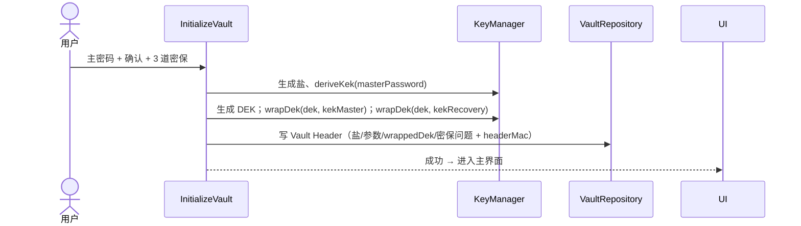
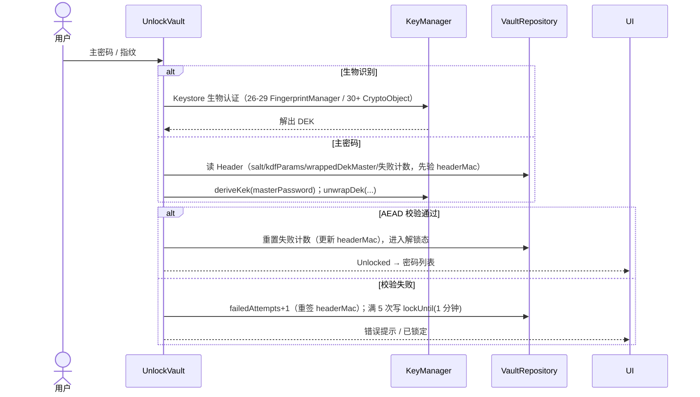
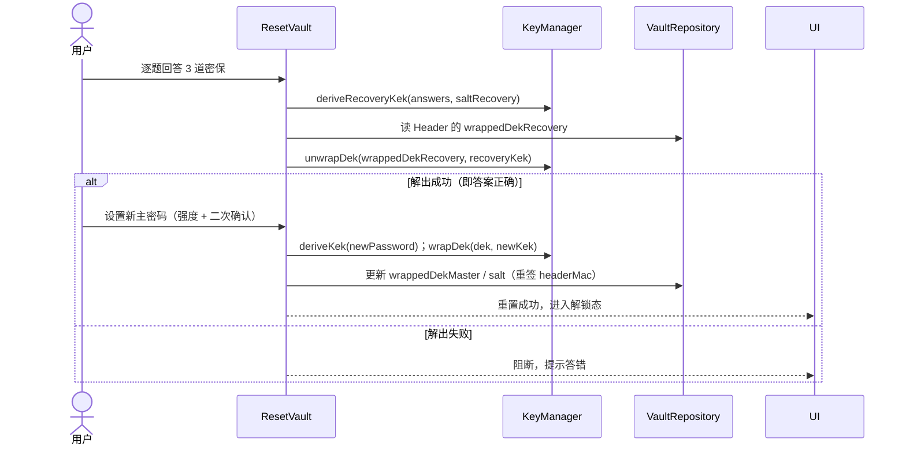

# 密码管理 App —— 技术方案

> 依据：`密码管理App_需求规格说明书.md`（v0.4）、`features/*.feature`、`架构视图.md`、`openapi.yaml`（预留）。
> 定位：Android 原生、纯本地、无服务端、个人使用。本文给出技术选型、架构、数据模型、接口、时序、任务拆解与风险。
> 版本：v0.3（已按 `技术方案评审意见.md` 的 B1/S1/S2/S3 及 M1–M4、G1–G5 修订，2026-09-21）。

## 修订摘要（v0.3）

| 评审项 | 处置 |
|---|---|
| **B1** 解锁循环依赖 | 存储拆为 **Vault Header（不依赖 DEK）+ Vault Body（SQLCipher，密钥=DEK）**，Header 加 HMAC 完整性（§4.1/§4.2） |
| **S1** 密保编码歧义 | 定义答案**规范化编码**（Trim → 定序 → 长度前缀+UTF-8 → KDF）（§4.2、T10） |
| **S2** 导入事务性 | 导出**临时文件+原子 rename**；导入**校验后原子提交、失败回滚**；全量导入=整库替换（T26–T28） |
| **S3** autofill 会话边界 | 明确会话共享/内联解锁机制与 DEK 生命周期（§3、T25） |
| M1–M4 / G1–G5 | 接口补齐、改密保并入 T10、锁定档位与易混淆验收、搜索归一化、生物识别版本分支、模块精简、单行约束、预留语义、T05 解耦 |

---

## 1. 推荐技术栈与框架（含理由）

| 层次 | 选型 | 理由 |
|---|---|---|
| 语言 | **Kotlin** | Android 现代标准；协程天然适配；空安全降低崩溃 |
| UI | **Jetpack Compose + Material 3** | 声明式、状态驱动，契合「密码掩码/显隐」等强交互；开发效率高 |
| 架构 | **MVVM + 单向数据流（UDF）+ 分层** | 状态单一来源，便于测试与安全审计 |
| 依赖注入 | **Hilt** | 官方推荐，减少样板 |
| 异步 | **Kotlin Coroutines + Flow** | 响应式；解锁态/锁定态用 `StateFlow` 驱动 |
| 本地存储 | **Room + SQLCipher** | 结构化查询（5000 条搜索/过滤）+ 整库静态加密（满足 NFR-S1 明文不落盘） |
| 密钥管理 | **Android Keystore（硬件级）+ Google Tink** | 密钥不出安全区；生物识别用 Keystore 授权解锁 |
| 密钥派生 KDF | **Argon2id**（备选 PBKDF2-HMAC-SHA256） | 抗 GPU/内存暴力破解，移动端参数需调优 |
| 加密切片 | **AES-256-GCM（AEAD）** | 认证加密，篡改即失效 |
| 生物识别 | **androidx.biometric** | 统一指纹/面容 API（含 API 26–29 兼容路径） |
| 自动填充 | **Autofill Framework（AutofillService）** | 系统级填充，覆盖浏览器/三方 App |
| TOTP | **RFC 6238（HMAC-SHA1 + Base32）** | 与主流站点兼容 |
| 构建 | **Gradle Kotlin DSL + version catalog** | 依赖集中、可复现 |
| 测试 | **JUnit / MockK / Turbine / Robolectric / Compose-UI-Test** | 分层层验证 |
| BDD 衔接 | 可选 **Cucumber-Android** 或 Gherkin→Espresso 映射 | 与 `features/*.feature` 对齐 |

> 版本基线：minSdk = API 26（Android 8.0+）；targetSdk = 当前最新稳定版（已定，见 §10）。

---

## 2. 整体架构设计

采用 **分层 + 单向数据流**，Domain 层为纯 Kotlin（不含 Android 依赖），便于测试与替换。

```mermaid
flowchart TB
    subgraph UI[表现层]
        Screen[Compose UI]
        VM[ViewModel + UiState / UDF]
    end
    subgraph Domain[领域层（纯 Kotlin）]
        UC[UseCase 用例]
        Ports[Repository 端口接口]
    end
    subgraph Data[数据层]
        Repo[Repository 实现]
        Header[(Vault Header · 不依赖 DEK)]
        Room[(Room + SQLCipher · 密钥=DEK)]
        KS[Android Keystore]
        File[(备份文件)]
    end
    subgraph Platform[平台层（系统服务）]
        Bio[Biometric]
        AF[AutofillService]
        Clip[ClipboardManager]
    end

    Screen --> VM --> UC
    UC --> Ports
    Ports <-.实现.- Repo
    Repo --> Header
    Repo --> Room
    Repo --> KS
    Repo --> File
    UC --> Bio
    UC --> AF
    UC --> Clip
```

**核心原则**

1. **安全边界内聚**：所有「敏感值不进明文、不入日志、不出进程」的处理集中在 `crypto` 与 `vault` 模块，UI 层拿不到原始密钥。
2. **解锁态门禁**：`VaultState`（Locked / Unlocked(session)）作为全局 `StateFlow`，所有用例入口执行前校验锁定态（对应 BR-7）。
3. **数据单向流**：事件 → `ViewModel` → `UseCase` → `Repository` → 结果回写 `UiState`；无 UI 直连存储。
4. **预留边界**：`openapi.yaml` 描述的远程 API 本期不实现。将来若加后端，可在 Data 层加远程 DataSource 实现同一组 `Repository` 端口——但**必须重新评估密钥托管与传输安全**（届时「DEK 不出端」的语义会被打破，令牌会话也需重新设计）。

---

## 3. 模块划分与职责

| 模块 | 职责 | 关键约束/对应需求 |
|---|---|---|
| `auth` | 主密码校验、生物识别开通/快捷解锁、连续 5 次限流 | FR-2、FR-1 |
| `crypto` | KDF、wrap/unwrap DEK、AES-GCM 加解密、规范化编码、Keystore 交互 | NFR-S1/S2、S1 |
| `vault` | Vault Header 读写、密保问题、失败计数、锁定状态、会话 | FR-1、FR-8、FR-12 |
| `entries` | 条目增删改查、分类/标签/搜索、5000 上限、删除二次确认 | FR-3、FR-5 |
| `generator` | 密码生成（长度/字符集/排除易混淆） | FR-4 |
| `totp` | Base32 解析 + RFC6238 动态码 | FR-11 |
| `autofill` | AutofillService、条目匹配、多候选、会话边界 | FR-6、S3 |
| `backup` | 加密导出、加密/CSV 导入、重复跳过、原子提交 | FR-7、S2 |
| `clipboard` | 掩码显隐、复制、30 秒清理 | FR-9 |
| `lock` | 切后台/空闲自动锁定 | FR-8 |
| `core` | 通用工具、DI、日志脱敏、Result 封装 | — |

> 说明（G2）：`lock` / `clipboard` 首期可作为 `vault` / `ui` 的内部组件实现，避免过早拆分模块、降低骨架复杂度。
> 说明（S3）：`autofill` 与主界面可能处于不同上下文。约定——填充时若主会话已解锁则复用之；若未解锁，则通过 `AutofillService` 提供**内联解锁**（主密码/生物识别）后再填充；DEK 生命周期仍遵循「切后台即清」，不因填充而延长驻留。

---

## 4. 数据模型设计

### 4.1 存储分层与实体

数据分两层（**关键修正 B1**）：解锁引导所需的数据必须能在「无 DEK」时读取，故独立于加密库。

**① Vault Header（前置头，不依赖 DEK）**

| 字段 | 说明 |
|---|---|
| `saltKdf`, `kdfParams` | 主密码派生参数（非机密，但需完整性） |
| `wrappedDekMaster` | 用主密码 KEK 包裹的 DEK（密文） |
| `wrappedDekRecovery`, `saltRecovery` | 用密保答案 KEK 包裹的 DEK（密文） |
| `failedAttempts`, `lockUntil` | 失败计数与锁定时钟（**必须开库前可读**） |
| `biometricEnabled` | 生物识别开关 |
| `headerVersion`, `headerMac` | 结构版本 + 对可变字段的 HMAC，防篡改 |
| `SecurityQuestion`(id, position, questionText) | **问题**文本（找回时展示）；**答案不落盘** |

- **存储位置**：独立于 SQLCipher 库（独立文件 / 独立密钥小库），**不依赖 DEK**，从而打破「开库需 DEK、取 DEK 需开库」的循环。
- **完整性**：`failedAttempts`、`lockUntil`、`wrappedDek*`、KDF 参数须经 `headerMac` 校验，防止攻击者清空计数/提前解锁绕过 BR-9 限流。
- **约束（G3）**：Header 为**单行单例**，带独立 `headerVersion`，可独立迁移。

**② Vault Body（主体，SQLCipher，密钥 = DEK）**

| 实体 | 字段 | 说明 |
|---|---|---|
| `Entry` | id, title, username, passwordCipher, url, notes, categoryId, createdAt, updatedAt, totpSecretCipher | `passwordCipher`/`totpSecretCipher` 用 DEK 二次加密 |
| `Category` | id, name | 1–30 字符 |
| `Tag` | name | 1–30 字符 |
| `EntryTag` | entryId, tag | 多对多；单条 ≤20 |

> 字段长度/必填约束与需求 §6 一致。Body 整库由 SQLCipher 加密（NFR-S1），`passwordCipher`、`totpSecretCipher` 额外用 DEK 字段级加密（纵深防御，D8）。
> 搜索（M4）：为大小写不敏感检索，`title/username/url` 建**归一化列（lower-case）并加索引**，避免对密文库做全表 `LIKE %q%`。

### 4.2 密钥与加密模型（核心）

```
主密码 ──Argon2id──> KEK_master ──wrap──> DEK ──encrypt──> SQLCipher 密钥
密保答案（规范化编码）──KDF──> KEK_recovery ──wrap──> DEK（用于找回重置）
生物识别 ──Keystore(setUserAuthenticationRequired)──> 授权解出 DEK（快捷解锁）
```

- **DEK（数据加密密钥）为唯一数据根密钥**，随机生成，永不明文落盘。
- 主密码与密保答案**都不直接存储**；能否用它们正确解出 DEK（AEAD 校验）即「答对/答错」的判据——因此密保答案不需要明文/哈希落盘。
- **密保答案规范化编码（修正 S1）**：每个答案先 Trim（去首尾空白）、保持大小写、按题号顺序，以「长度前缀 + UTF-8 字节」拼接（避免 `["ab","c"]` 与 `["a","bc"]` 同密钥的歧义），再进 KDF 派生 `KEK_recovery`；**设置与找回两端必须使用同一编码**。
- **忘记主密码的找回**：用密保答案派生的 `KEK_recovery` 解出 DEK，再用新主密码重新包裹 DEK —— 由此实现「重置主密码且数据保留」。
- **修改密保问题**（M2）：已解锁并验证当前主密码后，用新答案重派生 `KEK_recovery` 并重裹 DEK。
- **生物识别快捷解锁**：DEK 被一个 `setUserAuthenticationRequired(true)` 的 Keystore 密钥包裹，指纹/面容验证通过才释放；**API 26–29 走 `FingerprintManager` 兼容路径（经 androidx 封装），API 30+ 走 `BiometricPrompt.CryptoObject`**（G1）。
- **限流与头部完整性**：`failedAttempts/lockUntil` 位于 Header 且受 `headerMac` 保护，解锁失败在**开库前**即可计数与判定。

---

## 5. API 接口设计（内部接口签名）

> 仅内部接口；敏感参数一律 `CharArray`（可清零），尽量 `Result` 返回。

```kotlin
// crypto / 密钥
interface KeyManager {
    fun deriveKek(password: CharArray, salt: ByteArray, params: KdfParams): ByteArray
    fun deriveRecoveryKek(answers: List<CharArray>, salt: ByteArray): ByteArray  // 内部做规范化编码
    fun wrapDek(dek: ByteArray, kek: ByteArray): ByteArray
    fun unwrapDek(wrapped: ByteArray, kek: ByteArray): ByteArray
    fun encrypt(data: ByteArray, key: ByteArray): ByteArray   // AES-256-GCM
    fun decrypt(ciphertext: ByteArray, key: ByteArray): ByteArray
}

// vault / 认证与会话
interface VaultRepository {
    suspend fun initialize(req: InitializeRequest): Result<Unit>
    suspend fun unlock(password: CharArray): Result<Session>
    fun lock()
    suspend fun resetViaSecurityAnswers(answers: List<CharArray>, newPassword: CharArray): Result<Unit>
    suspend fun changeSecurityQuestions(answers: List<CharArray>, currentPassword: CharArray): Result<Unit>
    suspend fun changeMasterPassword(current: CharArray, new: CharArray): Result<Unit>
    suspend fun setBiometric(enabled: Boolean, password: CharArray): Result<Unit>
    val state: Flow<VaultState>            // Locked | Unlocked
}

// entries
interface EntryRepository {
    fun search(query: String, categoryId: String?, tag: String?): Flow<List<EntrySummary>>
    suspend fun get(id: String): Entry?
    suspend fun create(input: EntryInput): Result<String>      // 强校验 + 5000 上限
    suspend fun update(id: String, input: EntryInput): Result<Unit>
    suspend fun delete(id: String): Result<Unit>               // 调用方二次确认
    suspend fun revealPassword(id: String): Result<CharArray>  // 仅在解锁态
}

// categories / tags
interface CategoryRepository {
    fun list(): Flow<List<Category>>
    suspend fun create(name: String): Result<String>
    suspend fun delete(id: String): Result<Unit>               // 条目回退「未分类」
}
interface TagRepository { fun list(): Flow<List<String>> }

// totp / generator
interface TotpGenerator { fun code(secretBase32: String, timeMillis: Long): TotpCode }  // 6 位 + 剩余秒
interface PasswordGenerator { fun generate(spec: GenerateSpec): CharArray }

// backup
interface BackupRepository {
    suspend fun export(password: CharArray): Result<ByteArray>       // 原子导出
    suspend fun import(file: ByteArray, password: CharArray): Result<ImportSummary>
    suspend fun importCsv(file: ByteArray): Result<ImportSummary>    // 重复跳过
}
```

> `AutoLockManager`、`ClipboardManager` 属平台组件，接口在 T08 / T17 就近定义。

配套领域模型（要点）：`VaultState`、`Session`、`EntryInput`、`ImportSummary(imported, skipped, errors)`、`KdfParams`、`TotpCode`、`GenerateSpec`。

---

## 6. 关键流程与时序

### 6.1 首次初始化



### 6.2 解锁与生物识别



### 6.3 忘记主密码找回



---

## 7. 风险与权衡

| # | 风险 | 影响 | 应对 / 权衡 |
|---|---|---|---|
| R1 | **加密实现错误**（KDF/密钥包裹/加解密） | 数据永久丢失或泄露（最高风险） | 独立 `crypto` 模块 + 向量/往返单测；安全评审门禁；不自行发明算法 |
| R2 | KDF 参数与移动端性能 | Argon2 内存/时长过高致解锁卡顿 | 基准测试选参数；提供 PBKDF2 兜底 |
| R3 | SQLCipher 原生依赖 | 构建/兼容成本 | 已定 SQLCipher；版本收敛于 version catalog，覆盖迁移与 ABI 兼容 |
| R4 | 自动填充框架碎片化 | 部分 App/ROM 不支持，填充失败 | 降级为「复制手动粘贴」；FR-6 为 P2 |
| R5 | 剪贴板清理跨版本不一致 | Android 13+ 系统自动清理；旧版难以主动清 | 尝试清理 + 移除 App 内明文 + 提示；NFR-S4 已声明「尽力而为」 |
| R6 | TOTP 依赖设备时间 | 时间偏差致动态码不一致 | 显示错误时提示检查系统时间（FR-11 异常场景） |
| R7 | 密保问题熵可能低于主密码 | 找回通道成为最弱环节 | 3 道题且全对才重置；答案不落盘；安全评审确认 |
| R8 | 忘记主密码且忘记密保 | 数据不可恢复 | 属已定业务约束（BR-6）；UI 显著告警；强依赖备份导出 |
| R9 | 数据迁移/版本升级 | 升级崩溃或丢数据 | Header/Body 各自版本 + Room migration 测试 |
| R10 | 内存中明文残留（DEK/密码） | 越权读取 | 会话内最小化持有周期、切后台即锁、日志脱敏 |
| R11 | **Vault Header 被篡改**（清空失败计数/锁定时钟） | 绕过 BR-9 限流 | 可变字段加 `headerMac` 校验，校验失败即拒绝解锁（修正 B1） |
| R12 | 备份导入半途中断 | 数据损坏 | 临时库校验通过后原子替换；失败回滚（修正 S2） |

---

## 8. 实现任务列表

> 预估为单人全职；每任务 30–120 分钟，均可独立验证。验收标准遵循「可运行 + 可断言」。

| ID | 任务 | 依赖 | 验收标准 | 预估(分) |
|---|---|---|---|---|
| T01 | 工程初始化：Gradle Kotlin DSL + version catalog + Hilt + Compose + minSdk 26 落地 | — | 空壳可构建运行；CI 跑 lint/单测 | 90 |
| T02 | 分层骨架：core/domain/data/platform 模块与包结构 | T01 | 模块边界清晰、编译通过 | 60 |
| T03 | 接入 Room + SQLCipher（Body）与 **Vault Header 独立存储 + HMAC** | T01 | Header 可在无 DEK 时读写并验签；Body 可加密创建/打开 | 120 |
| T04 | 测试脚手架：JUnit/MockK/Turbine/Robolectric + CI 接入 | T01 | 示例单测可运行 | 60 |
| T05 | `KeyManager`：KDF、规范化编码、wrap/unwrap、AES-GCM + 单测 | —（纯算法，可与 T03 并行） | 加解密往返一致；篡改致失败；编码规范化用例一致 | 120 |
| T06 | 首次初始化用例（强度/二次确认、盐与参数、写 Header + headerMac） | T04,T05 | feature 01 相关场景通过 | 90 |
| T07 | 解锁用例（派生→解 DEK→判定；错误计数；满 5 次锁 1 分钟持久化） | T05,T03 | 正确解锁/错误计数/限流锁定 | 120 |
| T08 | 锁定 + 自动锁定（lock()、后台/超时触发、**档位可选：立即/30s/1min/5min**） | T07 | 锁定后入口禁用；各档时长生效 | 90 |
| T09 | 生物识别开通/关闭 + 快捷解锁（**API 26–29 / 30+ 分支**） | T07 | 指纹解锁；失败降级主密码；跨版本可用 | 120 |
| T10 | 密保设置 / 找回重置 / **修改密保**（规范化编码→recoveryKey→解/重裹 DEK） | T05,T06 | 答对重置、答错阻断；改密保需验主密码；两端编码一致 | 120 |
| T11 | 修改主密码（验旧→重裹 DEK→更新盐与参数，重签 headerMac） | T07 | 改后新密码可解锁、旧密码失效 | 90 |
| T12 | 会话/VaultState 管理（内存 DEK 生命周期、切后台清零） | T07,T08 | 重启/后台需重解锁；DEK 不落盘 | 90 |
| T13 | Entry 实体与 DAO（分类/标签关联、**归一化列与索引**、迁移） | T03 | CRUD 正确；密码字段密文；5000 条查询走索引 | 120 |
| T14 | EntryRepository + 用例（CRUD、校验、5000 上限、删除二次确认） | T13,T08 | CRUD + 校验 + 上限 | 120 |
| T15 | 条目列表/详情 UI（掩码、显隐、复制入口） | T14 | 列表/详情渲染；密码默认掩码 | 120 |
| T16 | 新增/编辑表单 UI + 校验提示 | T14,T15 | 必填高亮；保存成功 | 90 |
| T17 | 可见性与剪贴板控制（复制、30 秒清理、离开关明文） | T15 | 复制后 30 秒清；明文不残留 | 90 |
| T18 | 字段级加解密接入（password/totpSecret 用 DEK） | T05,T13 | 明文不落盘；解密仅在读取时 | 90 |
| T19 | 密码生成器（规则 + 安全随机源 + **排除易混淆字符**）+ UI | T17 | 规则生成；长度 4/64 边界；排除项生效 | 90 |
| T20 | **[二期]** TOTP 生成（Base32 解析 + RFC6238 HMAC）+ 单测 | — | 与 RFC 标准向量一致 | 90 |
| T21 | **[二期]** TOTP UI（6 位码 + 倒计时、复制、密钥录入校验） | T20,T17 | 展示/滚动/复制；非法密钥拦截 | 90 |
| T22 | 分类管理（DAO/用例/UI） | T13 | 增删；删除回退「未分类」 | 90 |
| T23 | 标签管理 + 条目多标签（上限 20） | T13 | 加删/去重/上限 | 90 |
| T24 | 搜索（标题/用户名/网址；**归一化列实现大小写不敏感**、trim）+ UI｜*主体已随 T15 于 M2 提前落地* | T13,T15 | 命中/空态；大小写不敏感一致 | 90 |
| T25 | **[二期]** 自动填充（AutofillService + 匹配 + 多候选 + **会话边界/内联解锁**） | T14 | 系统级填充；多候选选择；未解锁时内联解锁可填充 | 120 |
| T26 | 加密导出（打包 → AES-GCM → **临时文件 + 成功后原子 rename**） | T18 | 导出可解密；口令错误失败；中断不留半文件 | 120 |
| T27 | 备份导入（**临时库校验通过后原子替换** + 冲突策略；失败回滚）｜*内容格式须与容器解耦，见 §9.2* | T26 | 错误口令拒绝；失败原库不变；全量导入=整库替换需二次确认 | 120 |
| T28 | **[二期]** CSV 导入（模板校验、重复跳过、汇总；**事务性写入**） | T13 | 导入成功；缺列整体报错不落脏数据；跳过计数 | 90 |
| T29 | 安全加固：root 提示、日志脱敏、后台截图防护、内存清除 | T12,T17 | 日志无明文；root 提示 | 120 |
| T30 | 错误提示/空态统一 + 无障碍与多尺寸适配 | T15 | 提示明确可操作；可访问性通过 | 90 |
| T31 | 端到端验收（对照 feature 全量回归）+ 发布准备（签名/权限/隐私说明） | 全部 | feature 场景全绿；隐私说明就绪 | 120 |

---

## 9. 开发路线图与里程碑

| 里程碑 | 内容 | 含任务 | 出口标准 |
|---|---|---|---|
| **M0 工程骨架** | 工程、分层、Header/Body 存储、加解密库接入、CI | T01–T04 | 可构建、可测试、Header 可验签、空库可加密打开 |
| **M1 认证与密码库核心** | 初始化/解锁/锁定/生物识别/密保找回·修改/改密码 | T05–T12 | 解锁闭环可演示；**通过安全评审门禁** |
| **M2 条目管理** | 实体/DAO/CRUD/列表详情/剪贴板/字段加密 | T13–T18 | 条目全流程可用，明文不落盘 |
| ~~M3 密码生成器~~ | 生成器规则 + UI | T19 | ✅ **已随 v1 交付** |
| ~~M4 组织与搜索~~ | 分类/标签/搜索 | T22–T24 | 搜索已随 T15 交付；分类/标签移二期 |
| ~~M5 备份恢复~~ | 加密导出/导入 | T26–T27 | 移二期 |
| **v1 成品** | 补齐 :app 侧接线 + 自用签名 APK | 见 §9.3 | ✅ **已交付**（APK 可安装，FR-8/FR-12/P-07 设备走查通过） |
| **二期** | 分类、标签、加密备份、root 检测、无障碍、商店发布、TOTP、自动填充、CSV | T20、T21、T22、T23、T25、T26、T27、T28、T29 余项、T30、T31 全量 | 见 §9.2 预留设计 |

- 建议顺序：M0 → M1（关键路径、先做安全骨架）→ M2 → M3/M4 可并行 → M5 → M6。
- 单人全职估算 **一期约 3–4 周**（原 4–5 周含二期三任务）；M1 与 M6 各设一次安全评审门禁。

### 9.1 一期/二期范围划分（2026-09-24 用户拍板）

TOTP 动态码（T20/T21）、自动填充（T25）、CSV 导入（T28）移入**二期**，一期不做。
需求本身未取消——`需求规格说明书.md` 的 FR-6 / FR-11 / FR-7(CSV) 仍是规范，
对应 feature 场景保留并打 `@phase-2` 标签，二期直接作为验收基线。

| 移二期项 | 涉及需求 | 一期仍需交付的相关部分 |
|---|---|---|
| TOTP 动态码 | FR-11、S58–S62、§10.10 | 条目持有 TOTP 密钥的**存储与加密链路**（见 §9.2） |
| 自动填充 | FR-6、S38–S42、§10.6 | 会话边界与锁定期约束（见 §9.2） |
| CSV 导入 | FR-7 之 CSV、S43/S46 | 加密备份容器与原子替换（见 §9.2） |

**排期影响**：M3/M4/M5 各减少 1–2 个任务，估算下降约 1 周；
二期三项独立可插拔，不改动一期已交付的数据结构与会话机制。

### 9.2 移二期项的预留设计（一期落地，二期直接接续）

预留原则：**只预留「一期本就要建的通用结构」，不写二期的实现，也不建无实现的空接口**
（避免过度设计，参见评审「不过度抽象」结论）。凡需要新增类/字段的，均在下方标注已落地位置。

**TOTP（二期 T20/T21）— 已落地预留**

- `entries.totpSecretCipher` 列已在 M2 建表时预留（`EntryEntity`），与 password 同为 DEK 加密字段；
- `EntryDetail.totpEnabled` 已由 `totpSecretCipher != null` 派生，一期恒为 `false`；
- `EntryInput.totpSecret: CharArray?` 已加入输入模型，`create` 已按「非空则加密入库」处理，
  `update` 经 `existing.copy(...)` 天然保留原密钥——
  **二期只需加 TOTP 计算（纯函数 + RFC6238 向量单测）与 UI，不动 schema、不动迁移、不动数据层结构**；
- 待办：Base32 解析与 6 位码滚动属 T20，密钥录入格式校验（非法 secret 拒绝保存）已在 §6 规则中。

**自动填充（二期 T25）— 约束已记录，代码不预留**

- 二期的主要风险不是「写 AutofillService」，而是**会话边界**：`AutofillService` 无 Activity、
  拿不到 `VaultViewModel`，不能复用 UI 那条「解锁到自动锁定」的会话。
  一期 `VaultSessionManager` 的 KDoc 已写明该约束，二期必须实现**自持、短生命周期、用后即锁**
  的独立会话（与评审 S3 同一工作项）——否则自动填充会成为「绕过自动锁定」的旁路。
- 一期不做 manifest 声明、不做服务占位类：这类壳在需求未定前建立只会误导。

**CSV（二期 T28）— 架构约束已记录**

- 加密备份容器（T26/T27）与**内容格式**必须解耦：容器只负责「打包 → AES-GCM → 原子落盘」
  与「解密 → 校验 → 原子替换」，CSV 作为独立的编解码器接在容器内侧。
- 因此 T27 实现时**不得**把条目序列化逻辑写死在导入流程里，否则二期 CSV 会逼着重写容器。
- 一期备份仅覆盖本应用自有格式（`VaultBackup`），二期新增 CSV codec 与之并列。

---

## 10. 架构决策记录（已定）

以下 10 项已于 2026-09-21 拍板：

| # | 决策点 | 结论 |
|---|---|---|
| D1 | 版本基线 | minSdk = **API 26（Android 8.0+）**；targetSdk = 当前最新稳定版 |
| D2 | 静态加密方案 | **SQLCipher + Room**（整库加密） |
| D3 | KDF 算法 | **Argon2id**（具体内存/迭代参数在 M1 基准校准） |
| D4 | 密保答案存储 | **不落盘**，以解出 DEK 判对错；保留 M1 安全评审门禁 |
| D5 | 备份格式 | **自定义加密 JSON**（AES-GCM 加密，不做 KDBX） |
| D6 | 自动填充 | **实现系统级 AutofillService** |
| D7 | TOTP 密钥录入 | **手动 Base32 输入**（扫码列为后续可选） |
| D8 | 字段级二次加密 | **采纳**（password/totpSecret 用 DEK 加密） |
| D9 | 剪贴板旧版兜底 | **尽力清理 + 明确提示** |
| D10 | BDD 自动化 | **先作规格/验收清单**，后续择机 Cucumber-Android |

> 实现期仍需校准（非阻塞）：Argon2id 具体内存/迭代量、SQLCipher 库版本与迁移细节、无指纹设备的生物识别降级提示文案。

### 9.3 v1 成品冲刺（2026-09-24，已交付）

M0–M2 完成后 :app 侧审计发现**多项已实现且有单测的能力在真机上不可达**，其中
FR-8 自动锁定**一行接线都没有**（实际行为是「永不自动锁定」）。故 v1 不是加功能，
而是**补接线 + 出一个可安装 APK**。

| 项 | 内容 | 性质 |
|---|---|---|
| V1-1 | FR-8 自动锁定接线 | 接线（并修掉 AppNav 只在 List 分支判锁定的缺陷） |
| V1-2 | FR-12 密保找回接线（P0） | 接线 |
| V1-3 | P-07 修改主密码接线 | 接线 |
| V1-4 | FR-2 生物识别快捷解锁 | **数据层补完**（原只翻开关、从不 wrap DEK） |
| V1-5 | T19 密码生成器 | 新增 |
| V1-6 | 自用签名 + 错误文案人话化 + 空态 + FLAG_SECURE | 收尾 |

**设备走查发现并修复的 2 个真实缺陷**（单测无法覆盖）：

1. **首次初始化后 UI 停在创建表单**——`VaultUiState.initialized` 只在构造时读一次
   Header，创建成功后未置位，`AppNav` 仍按「未初始化」渲染。
2. **锁定时详情/编辑页不回退**——`AppNav` 仅在 List 分支检查 `state.locked`。

**设备走查能力**：`FLAG_SECURE` 使截图全黑（符合预期，防后台截图），
故走查改用 `uiautomator dump` 读无障碍树；输入经 `adb shell input`，注意软键盘
弹出后布局会滚动，坐标需重新 dump 后取值。

**未能在本机验证**：生物识别端到端（模拟器无已录入的 Class-3 强认证），需真机补跑。

---

## 10. 设计稿驱动的功能增强（v0.8，2026-09-24）

依据 `功能点提取与处置清单.md`。本节描述把设计稿功能点落到现有架构的方案；
任务编号自 T32 起，里程碑记为 **V2**。

### 10.1 数据模型变更（schema v2 → v3）

| 变更 | 内容 | 迁移要点 |
|---|---|---|
| `entries.favorite` | `Boolean NOT NULL DEFAULT 0` | 旧数据默认未收藏 |
| `entries.type` | `TEXT NOT NULL DEFAULT 'ACCOUNT'` | 旧数据默认「账号」，与 FR-15 默认值一致 |
| `categories` | 补 `createdAt`、`ON DELETE SET NULL` 外键 | 现有 `entries.categoryId` **无外键**，删除分类不会自动回退，须在 `CategoryDao.delete` 内显式把 `entries.categoryId` 置 null（需求 §6.5） |
| 索引 | `entries.favorite` | 与 `categoryId` 同级，供 chips 筛选 |

> 迁移必须经 `MigrationTestHelper` 仪器测试验证（沿用 T13 建立的迁移测试基线）。
> `data/schemas/` 需提交新的 `3.json`。

**为什么不加外键**：`ON DELETE SET NULL` 依赖外键约束，但现有 schema 未建外键。
两种选择：

- 方案 A：加外键 + `SET NULL`，由数据库保证回退；需先清理可能存在的孤儿 `categoryId`。
- 方案 B（**推荐**）：不加外键，由 `CategoryRepository.delete` 在**同一事务**内先 `UPDATE entries SET categoryId = NULL` 再 `DELETE FROM categories`。理由：删除分类是低频操作，显式事务比引入外键级联更易推理，也不必为历史脏数据写迁移清洗逻辑。

### 10.2 新增领域层

| 类型 | 位置 | 职责 |
|---|---|---|
| `EntryType` | `domain/entries` | 枚举 `ACCOUNT / BANK_CARD / WIFI / DOCUMENT`，附副标题渲染策略 |
| `PasswordStrength` | `domain/password` | 纯函数：`(CharArray) -> 强度等级 + 分数`，**复用 `PasswordPolicy` 的字符分类语义**，不重复实现 |
| `SecurityReport` | `domain/security` | 扫描结果模型：总数 / 弱密码 id 列表 / 重复分组 / 长期未更新 id 列表 |
| `SecurityScanner` | `domain/security` | 端口：`suspend fun scan(): SecurityReport` |
| `UserPreferences` | `domain/preferences` | 端口：自动锁定档位、默认密码长度、默认字符集 |

**强度算法**：字符类数 × 长度分档。不引入 zxcvbn 之类大依赖（体积与维护成本），
只做「弱/中/强/非常强」四档的启发式判定——**定位是用户提示，不是强度宣称**。

**重复密码检测的明文纪律**：比对必然需要解密。实现须：
1. 仅在解锁会话内执行（复用 `VaultSessionManager.requireUnlocked()` 门禁）；
2. 用完**立即** `fill(0)` 清零中间明文数组；
3. 扫描期间若收到锁定信号，中止并清零（不把明文留到后台）；
4. 结果模型只携带 `entryId`，**不携带任何密码明文**。

### 10.3 导航架构重构（四标签）

现状是 `AppNav` 单栈（`List / Detail / Edit / Settings`）。设计稿要求底部四标签。
**不引入 navigation-compose**（延续 T15 的「3 屏规模不引」决策，现为 4 个一级页 + 若干二级页，
手写栈仍够用且更可控）。

```
AppNav
├── Scaffold(bottomBar = 4 个 Tab)
└── 栈（每个 Tab 各自持有一个栈，互不干扰）
    ├── 密码 Tab: List → Detail → Edit
    ├── 生成 Tab: Generator
    ├── 安全 Tab: SecurityCenter → Detail(跳转修改)
    └── 设置 Tab: Settings
```

- 锁定门禁仍提到**所有屏之上**（V1-1 的教训），锁定时清空全部 Tab 栈；
- 「去修改」跳转：安全 Tab → 密码 Tab 的 Detail，需支持跨 Tab 导航；
- 快速锁定：列表页右上角图标（FR-17）。

### 10.4 安全中心实现要点

- 扫描在 `Dispatchers.Default`（CPU 密集的重复比对）+ 仓库 IO；
- `updatedAt` 判定直接查库，不需解密，**优先执行**，弱/重复判定后置；
- 重复分组用哈希分组而非两两比较，避免 O(n²)；
- 「长期未更新」阈值 180 天为常量，需在设置中可配置则另开 FR（本期不做）。

### 10.5 偏好存储

引入 `DataStore Preferences`（`androidx.datastore:datastore-preferences`），
经 `UserPreferences` 端口暴露。键：`auto_lock_duration`、`default_password_length`、
`generator_sets`、`generator_exclude_ambiguous`。

> 不直接用 `SharedPreferences`：需要类型安全与协程 API，与现有全协程数据层一致。

### 10.6 任务拆解（V2，30–120 分钟粒度）

| 任务 | 内容 | 依赖 | 验收标准 | 预估 |
|---|---|---|---|---|
| T32 | `EntryType` 枚举 + 副标题渲染策略 + 单测 | T13 | 四种类型各有渲染用例；默认账号 | 60 |
| T33 | schema v3 迁移（`favorite`/`type`/索引）+ `3.json` + 迁移测试 | T13 | MigrationTest 验证旧库升级后字段与默认值正确 | 90 |
| T34 | `CategoryDao.delete` + `CategoryRepository`（新增/改名/删除/回退未分类） | T33 | 删除分类后条目保留且 `categoryId` 为 null | 90 |
| T35 | 分类管理 UI + 列表 chips 筛选（含「全部」「收藏」） | T34 | chips 单选互斥；筛选结果正确 | 120 |
| T36 | 收藏星标（列表项 + 条目详情开关 + `favorite` 筛选） | T33 | 星标切换即时生效 | 60 |
| T37 | `PasswordStrength` 纯函数 + 单测（四档边界） | T19 | 4/8/16/64 位与字符类组合判定正确 | 60 |
| T38 | 生成器页面化（常驻结果、强度条、重新生成、复制按钮） | T37 | 四个 feature 场景通过 | 90 |
| T39 | `UserPreferences` 端口 + DataStore 实现 + 接线 | — | 偏好读写往返；进程重启后仍生效 | 90 |
| T40 | 自动锁定档位可配（设置 UI + 应用 `onForeground`） | T39 | 四档选择后倒计时行为随之变化 | 60 |
| T41 | 默认密码长度设置联动生成器初值 | T39 | 生成器初值取自设置 | 45 |
| T42 | `SecurityScanner` 领域层 + 明文纪律 + 单测 | T14, T18 | 弱/重复/长期未更新三类判定正确；结果不含明文 | 120 |
| T43 | `SecurityCenter` 页面（统计卡 + 需处理 + 去修改） | T42, 35 | 四类统计正确；跨 Tab 跳转到条目 | 120 |
| T44 | 底部四标签导航重构（`AppNav` 拆分 + 锁定门禁上提） | T35 | 四 Tab 切换；锁定清空全部栈 | 120 |
| T45 | 列表页增强（条目计数、收藏星标、类型头像、掩码卡号副标题） | T32, T36 | 四种类型副标题渲染正确 | 90 |
| T46 | 关于页 + 信任文案改写（去掉「端到端·零知识」） | — | 文案与实际能力一致 | 45 |
| T47 | 条目编辑页增强（顶栏保存、分类选择、标签折叠区） | T34 | 分类可选可清；标签多选保留 | 90 |

**合计约 18.5 小时**（不含缓冲）。V2 与二期后续任务（T20/T21/T25/T26–T31）彼此独立，可并行排期。

### 10.7 风险与权衡

| # | 风险 | 应对 |
|---|---|---|
| V2-1 | 导航重构可能破坏 v1 已验证的锁定门禁 | 锁定门禁上提至 `Scaffold` 之上；重构后必跑装机冒烟（V1 的 10 项走查） |
| V2-2 | 重复密码检测需解密全部密码，暴露面与耗时增加 | 仅解锁态执行；用完立即清零；5000 条规模逐条解密约 1–2 秒，可接受；结果模型不含明文 |
| V2-3 | `favorite`/`type` 加列使 Header/Body 迁移复杂 | 沿用已验证的 `MigrationTestHelper` 流程，提交 `3.json` |
| V2-4 | 强度算法可能给用户虚假安全感 | 文案只说「强度评级」不说「安全等级」；弱密码判定直接复用主密码强度规则，口径统一 |
| V2-5 | 分类与标签双维度增加认知负担 | 分类仅用于筛选（单选），标签仅用于归类（多选），UI 上分区呈现、不混排 |

### 10.8 明确不做

- **云同步/账号**（C1）——个人自用无需求，引入即需服务器与传输安全
- **联网泄露检测**（C2）——需 INTERNET 权限，破坏纯本地承诺
- **TOTP 两步验证统计**（C4）——随 T20/T21 一起进二期
- **真·端到端加密**（C5）——无服务端即无传输链路，文案改写而非造概念
