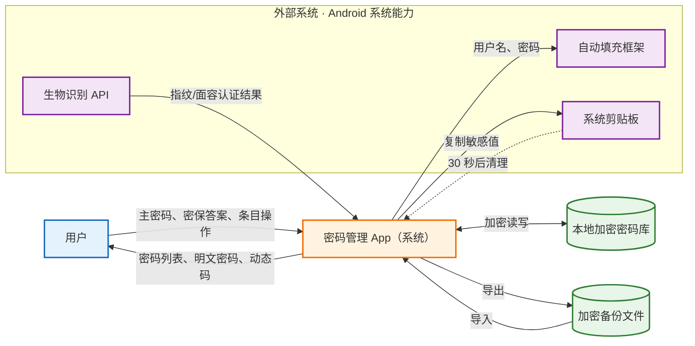
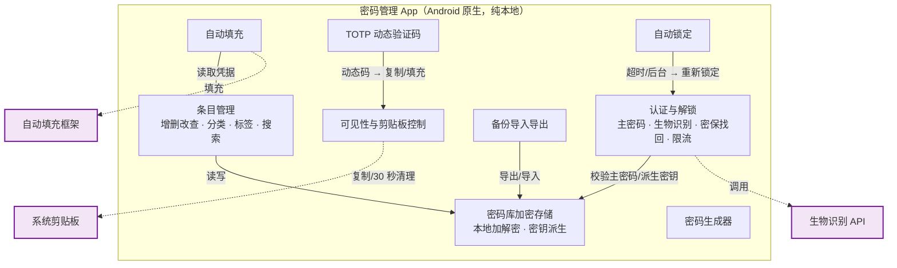
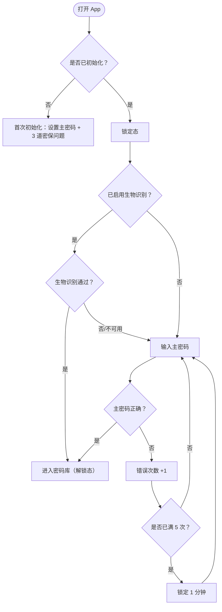
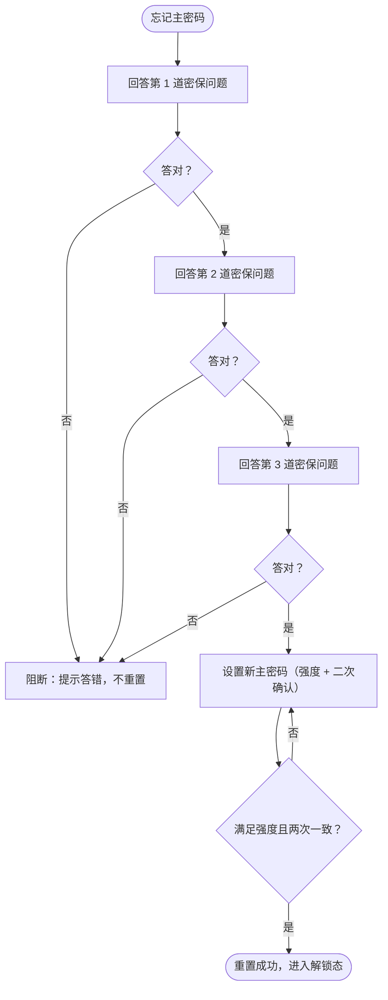

# 架构视图（Mermaid）

> 依据：`密码管理App_需求规格说明书.md`（v0.4）。
> 说明：当前产品为**纯本地、无登录、无云端**，故图中不出现网络或服务端；外部参与者仅为 Android 系统能力。仅绘制必要部分。

## 1. 系统上下文图

**图例**

- 橙色＝系统（本 App，设计范围内）
- 蓝色＝用户（外部角色）
- 绿色＝本地数据（加密密码库 / 备份文件）
- 紫色＝外部系统（Android 系统能力）
- 实线箭头＝主要数据流；虚线箭头＝异步/触发动作（如剪贴板定时清理）

## 2. 组件图

**模块职责（简要）**

| 模块 | 职责 | 关键约束 |
|---|---|---|
| 认证与解锁 | 主密码校验、生物识别、密保找回、连续 5 次限流 | 唯一的访问入口（BR-7） |
| 密码库加密存储 | 本地加解密、密钥派生 | 明文绝不落盘（NFR-S1） |
| 条目管理 | 增删改查、分类/标签/搜索 | 上限 5000；密码必填非空 |
| 密码生成器 | 按长度/字符集生成 | 长度 4–64 |
| 自动填充 | 向目标表单填入凭据 | 多候选时提供选择 |
| TOTP | 生成 6 位动态码 | 30 秒滚动 |
| 备份导入导出 | 加密备份、CSV 导入 | 口令保护；CSV 重复跳过 |
| 可见性与剪贴板 | 掩码显隐、复制 | 30 秒清理剪贴板 |
| 自动锁定 | 后台/空闲触发 | 默认 1 分钟 |

> 认证与解锁是**所有功能的前置门槛**：未解锁时，条目、生成器、自动填充、TOTP、备份、复制一律禁用（BR-7「自动锁定优先于便利」）。

## 3. 流程图：解锁与认证

## 4. 流程图：忘记主密码找回

